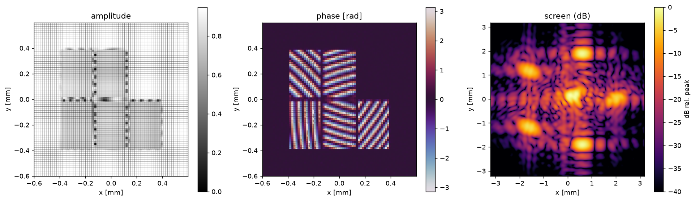
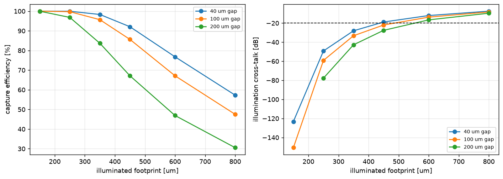
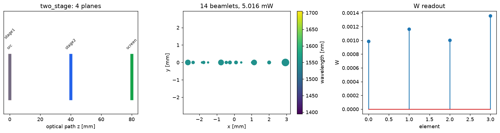
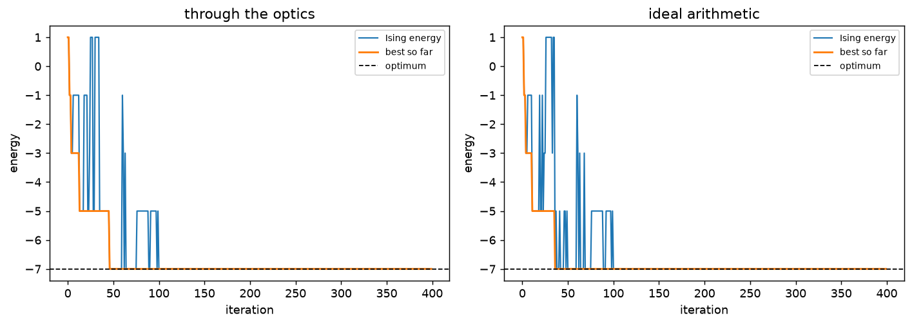
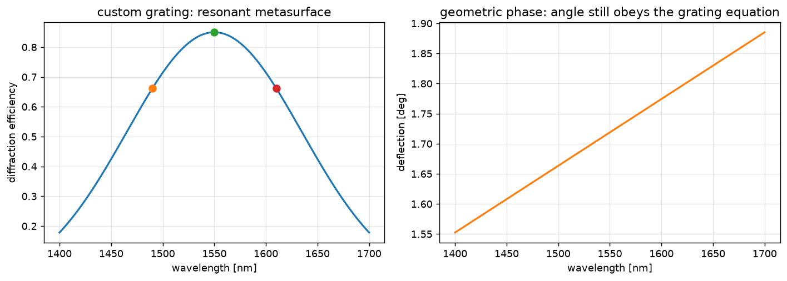
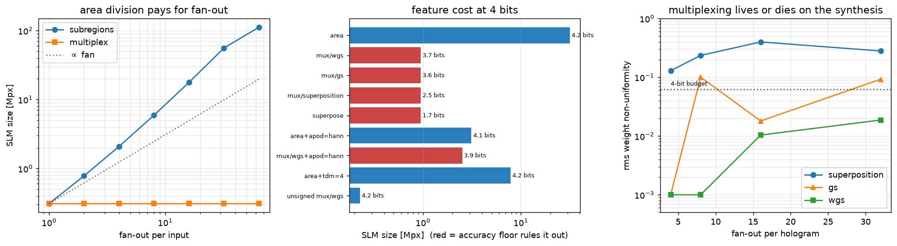
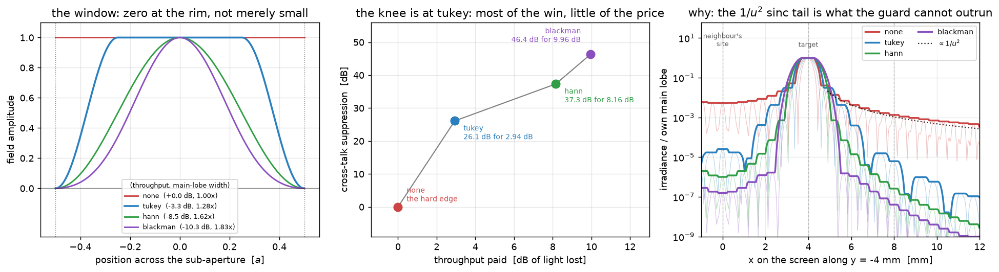
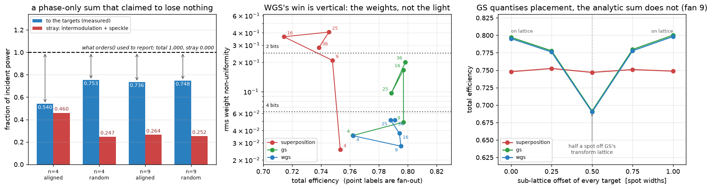

# fsphotonix

A large-scale **free-space photonic system simulator**: light sources illuminating a
modulator array of holographic gratings, free-space propagation to a detection
screen (or to another modulator array), electronic readout, and single- or
multi-stage local/global feedback loops.

Every component slot is a plugin, so a custom technology drops in without touching
the simulator.

```
sources ──▶ collimator/lenslet ──▶ modulator array ──▶ free space ──▶ screen ──▶ electronics ──┐
            (tunable footprint)    regions × CGH        propagation    camera /   analog or     │
                                   sub-regions                         PD / SMF /  digital      │
                                        ▲                              MMF / SPAD  pipeline     │
                                        │                                 │                     │
                                        └──────── local & global feedback ─┴─────────────────────┘
                       (or: the screen is another modulator array → multi-stage cascade)
```

## Install

```bash
pip install -e ".[dev]"
```

Only `numpy` is required. `scipy` improves the Dammann grating optimiser and the
Bessel-order checks, `matplotlib` enables `fsphotonix.viz`, `pyyaml` enables YAML
configs, and `cupy` switches the whole simulator to GPU via
`fsphotonix.engine.use_backend("cupy")`.

## 60-second tour

```python
import fsphotonix as fp

# a panel of 4 illuminated regions on a MEMS piston micro-mirror array
panel = fp.ModulatorArray.tiled(nx=4, ny=1, pitch=900e-6, gap=100e-6,
                                device="ipms_piston")

# every region fans its light out to the same three screen locations,
# by dividing into sub-apertures that each carry one focusing hologram
panel.broadcast([(-3e-3, 0.0), (0.0, 0.0), (3e-3, 0.0)], z=80e-3,
                tiling="stripes", gap=20e-6)

system = fp.build_relay(
    source=fp.TransceiverBank(n=4, pitch=900e-6, baud=25e9),  # COTS optics
    modulator=panel,
    detector=fp.CameraArray(nx=256, ny=64, pitch=25e-6),
    z=80e-3, spot_mode=True)

trace = system.run()
print(trace.outputs["screen"])            # camera frame
print(trace.spot_lists["panel"].summary())  # analytic beamlet table
```

Command line:

```bash
fsphotonix plugins                      # inventory every registered technology
fsphotonix run configs/fanout.yaml      # run a declarative system
fsphotonix mvm --n-in 8 --n-out 8       # build and characterise an optical multiply
fsphotonix aim -n 12 --iterations 400   # Max-Cut through the optics
```

## What it looks like

One illuminated region divided into five sub-apertures, each carrying its own
off-axis focusing hologram aimed at a different point on the screen. The device's
fill-factor dead space is visible in the amplitude; the five fringe orientations in
the phase are the five deflections; the screen shows the ring plus the residual
zero order that a finite-efficiency modulator always leaves on axis.



The illumination trade-off this architecture cannot escape. Widening the
collimated footprint fills more of the hologram aperture, but the overspill crosses
the guard gap onto the neighbouring input's hologram and is diffracted to *that*
input's targets. A wider guard gap buys cross-talk margin and costs throughput.



A two-stage cascade, where stage 1's detection screen is replaced by a second
modulator array: the plane layout, the 14 beamlets leaving stage 2, and the
four-element readout.



Max-Cut on the analog iterative machine, solved through real propagation (left)
against the ideal-arithmetic control (right). Both reach the brute-force optimum;
the optical loop takes roughly twice as many iterations to settle, which is the
cost of the photonics made visible.



A plugged-in technology the package does not ship: a resonant metasurface whose
efficiency is strongly wavelength dependent while its phase is geometric, so the
deflection still follows the grating equation.



Sizing a machine from a problem instance rather than checking a layout: how the
panel grows with fan-out under area division but not under phase multiplexing,
what each architectural feature costs at a 4-bit target, and the measurement that
decides whether multiplexing is usable at all — a naive analytic superposition
delivers its weights to ~30% rms, weighted Gerchberg-Saxton to 1–2%.



Tapering a sub-aperture's amplitude to zero at its rim instead of guarding it with
dead space. A hard edge has sinc far-field wings falling only as 1/u², which across
a lattice of driven detectors is a cross-talk floor no guard band escapes; a window
replaces them with a far faster roll-off, paid for in light and in a wider spot.
Measured through real propagation, Tukey is the bargain — 26 dB of cross-talk
suppression for 2.9 dB of throughput, because its flat centre keeps the light while
the taper still reaches zero.



What phase multiplexing really costs. One sub-region can carry N holograms at once
by summing them and keeping only the phase, which stops the panel scaling with
fan-out — but the projection scatters power into intermodulation and speckle, and
the code used to report that it lost nothing at all. Measured honestly, a
random-phase superposition delivers about 0.75 of its light to the designed spots,
and the choice of synthesis shows up in the *weights*: weighted Gerchberg-Saxton
delivers them to a few percent where the analytic sum spreads them by tens.



Regenerate all of them with:

```bash
for f in examples/0*.py; do python "$f" --save docs/figures; done
```

## What is modelled

### 1. Light sources — `fsphotonix.sources`
| plugin | what it is |
|---|---|
| `coherent_laser` | single frequency, optionally split N ways **mutually coherent** |
| `laser_array` | N independent lasers — mutually incoherent, per-emitter drive |
| `cots_transceiver` | bank of COTS transceivers whose centre frequencies scatter inside one 100 GHz slot: same nominal wavelength, **mutually incoherent** |
| `cwdm_bank` | genuinely different wavelengths (CWDM grid or a custom list) |
| `wdm_comb` | ITU-grid comb, coherent or incoherent lines |
| `collimated_array` | emitters behind a **lenslet array** with a tunable illuminated footprint |

Temporal modulation is a first-class object (`fsphotonix.waveform`): `cw`,
`nrz`/`ook` (with extinction ratio and rise time), `pam`, `rz` pulse trains
(gaussian/sech/square/lorentzian, chirped), `sinusoid`, `chirp`, `sampled`
(arbitrary waveform generator), `burst`, and `mixed` — a digital envelope carrying
an analog sub-carrier. `noisy` adds RIN and laser phase noise.

Space and time stay factorised (`u(x,y) · a(t)`), which is what lets the simulator
scale: propagation runs once per spatial mode and the time axis is only expanded at
the detector.

**Coherence is explicit.** Channels sharing a tag interfere; different tags add in
intensity only. One laser split N ways → one tag. N COTS parts in one 100 GHz slot
→ N tags, because a ~100 GHz beat note is far outside any camera or photodiode
bandwidth.

### 2. Collimator / illumination — `fsphotonix.sources.collimator`
`Collimator` is the Gaussian-optics model of one emitter behind one lenslet. The
illuminated **area is tunable** through the defocus, and `solve_defocus` inverts the
relation for you:

```python
src = fp.sources.CollimatedArray(n=5, pitch=500e-6, distance=6e-3,
                                 illumination_diameter=450e-6,   # the knob
                                 stray_fraction=0.02)            # lenslet leakage
```

`MicrolensArray` is the wave-optics version (real per-lenslet phase, aperture and
dead-space leakage) when the lenslet diffraction itself matters.

### 3. Modulator array — `fsphotonix.modulators`
`ModulatorArray` → `Region` (one illuminated patch) → `SubRegion` (one hologram).
A region with several sub-regions fans out by area division; a region with one
`multispot` CGH does it by phase multiplexing.

*Geometries*: `rect`, `circle`, `ellipse`, `annulus`, `sector`, `hexagon`,
`polygon`, `custom` bitmap, plus boolean combination and five sub-region tilings
(`stripes`, `grid`, `sectors`, `rings`, `interleave`).

*Gratings*: `blazed` (period, orientation, blaze depth, quantisation levels),
`binary_phase`, `ronchi` amplitude, `sinusoidal`, `crossed` 2-D, `dammann`
(equal-intensity fan-out, transition points optimised numerically for any N),
`fresnel_lens`, `spot_focuser` (off-axis focusing — "send this region's light to
*that* point"), `axicon`, `zone_plate`, `multispot` CGH (superposition or
weighted Gerchberg–Saxton), `phase_map` (load a hologram from a file),
`superposition`, `cascade`, `apodizer`.

*Devices* (reflective **and** transmissive): `lcos`, `transmissive_lc`,
`amplitude_slm`, `ipms_piston` (Fraunhofer-IPMS-style MEMS piston array),
`tilt_mirror` (analog tilt, projected onto per-mirror ramps), `dmd` (binary
micromirrors with `amplitude` / `lee` / `error_diffusion` encoding and the mirror
blaze condition), `ideal`. Each applies pixelation, phase quantisation, limited
stroke, inter-pixel cross-talk, fill-factor dead space, flatness error, dead pixels
and insertion loss.

### 4. Propagation — `fsphotonix.propagation`
`angular_spectrum` (exact, band-limited), `fresnel_tf`, `fresnel` (chirp-z **zoom**
Fresnel onto an arbitrary output grid — the workhorse, because the screen is
usually much larger and coarser than the panel), `fraunhofer`, `fourier_plane`,
`thin_lens`, `relay`, `aperture_stop`, `phase_screen` (turbulence/aberration),
`misalign`. `auto` picks a kernel from the sampling regime; `suggest()` reports it.

`SpotPropagator` is the scaling route: each sub-region becomes one beamlet, its
grating's analytic orders are looked up, and each order is deposited as one spot.
Cost is O(sub-regions × orders), independent of screen resolution, and the spot
**table** is usable without ever rasterising an image.

### 5. Detection screen — `fsphotonix.detectors`
| plugin | model |
|---|---|
| `camera` | CCD/CMOS: QE, exposure, shot noise, dark current, PRNU, read noise, full well, ADC, global/rolling shutter |
| `photodiode` | PIN/APD array: responsivity, bandwidth (real RC filtering of the waveform), dark current, TIA and thermal noise, APD gain + excess noise |
| `smf` | single-mode fibre array — coherent overlap integral, so it selects one direction *and* one mode |
| `mmf` | multimode fibre array — core aperture × NA acceptance cone, modal noise |
| `bolometer` | calibrated total-power sensor |
| `custom` | any `func(fields, t)` |

### 6. System, electronics and feedback — `fsphotonix.system`
Planes are `SourceStage`, `ModulatorStage`, `DetectorStage`, `ElementStage`,
`FunctionStage`, ordered by optical path length. **Replacing the detection screen
with another modulator array is just putting a `ModulatorStage` where the
`DetectorStage` was** — that is the multi-stage cascade.

Electronics are `LogicBlock`s: `gain`, `normalize`, `threshold` (with hysteresis),
`quantize` (ADC), `nonlinearity`, `lut`, `matrix`, `boolean` (gates over index
pairs), `register` (clock latency), `integrator`, `noise` (annealed), and
`pipeline` to chain them. `analog_path()` has zero latency; `digital_path(stages=k)`
has k clock cycles of it.

`Loop` binds *sense → process → actuate* with its own `period`, `delay`,
`priority`, `scope` and slew limit, so a fast local servo and a slow global solver
loop coexist. Actuators write per-region piston or gain, per-emitter drive, or a
whole re-routing of the holograms. `Machine` schedules them.

### 7. Applications — `fsphotonix.solvers`
`OpticalMVM` assembles a complete matrix-vector multiplier and handles dual-rail
encoding for signed inputs and signed weights (light cannot be negative), plus
calibration against the requested matrix. `AnalogIterativeMachine` closes an
annealed loop around it to minimise Ising/QUBO objectives — the AIM architecture.
`optics=None` gives the ideal-arithmetic control, so the difference between the two
convergence curves is attributable entirely to the photonics.

## Design notes the simulator will make you confront

These are not caveats about the model; they are properties of the architecture that
the model reproduces, and they have dedicated reporting.

**Illuminated area vs cross-talk.** Widening a lenslet's footprint fills more of
the hologram aperture, but the overspill crosses the guard gap onto the
*neighbouring* input's hologram, which diffracts it to that input's screen targets.
`analysis.illumination_crosstalk` and `illumination_sweep` quantify the trade;
`examples/02_collimator_crosstalk.py` prints the curve. At a 500 µm region pitch
with a 100 µm guard gap, a 450 µm footprint captures 86% of the light at −22 dB
cross-talk, while an 800 µm footprint captures 48% at −8 dB.

**The two hologram gaps.** `ModulatorArray.tiled(gap=...)` is the guard band
*between inputs*; `route(..., gap=...)` is the guard band *between the sub-holograms
of one input*. The second costs aperture and therefore widens every screen spot by
λz/a, so it cannot be increased indefinitely without re-introducing cross-talk at
the *detector*. `analysis.cgh_gap_report` reports both, plus whether the resulting
spot still fits inside the target pitch (`detector_guard_ok`).

**Column normalisation of a diffractive matrix.** A hologram can only redistribute
the light its region receives, so an area-multiplexed matrix is intrinsically
column-normalised. `set_matrix(normalize_columns=True)` restores the true matrix by
attenuating regions — which means throwing light away in every column weaker than
the strongest. That is a real power cost, not a modelling artefact.

**Angle sensitivity of a cascade.** A thin diffractive element adds its grating
vector to the *incident* one, so a hologram designed for normal incidence
mis-points by ≈ z·α when fed off-axis. Pass `incident=` (see `incidence_from`) to
design for the real incidence; a plane fed from several directions needs a
telecentric relay or angle-multiplexed sub-gratings. `examples/03` measures it.

**Dispersion.** A diffractive deflector obeys the grating equation, so a WDM bank
walks across the screen: `analysis.chromatic_walkoff` gives the displacement, and
the tests confirm 1450/1550/1650 nm land at 3.74/4.00/4.26 mm through one hologram.

**Steering range.** A modulator cannot write a grating finer than two pixels per
period, so `θ_max = arcsin(λ/2p)` — 2.8° for a 16 µm MEMS pitch at 1550 nm. Asking
for more does not fail quietly: the written grating *aliases* and the light goes
somewhere else, in the beamlet path as well as the wave path. `OpticalMVM` warns at
construction and `check()` reports the margin.

## Layout

```
fsphotonix/
  engine.py       backend (numpy/cupy), FFTs, Bluestein chirp-z / zoom DFT
  units.py grid.py fields.py waveform.py registry.py
  sources/        base, profiles, layout, lasers, cots, collimator
  modulators/     geometry, devices, array, gratings/{periodic,dammann,lenses,cgh,composite}
  propagation/    kernels, optics, spot (beamlet)
  detectors/      camera, photodiode, fiber
  system/         stages, optical_system, logic, feedback
  solvers/        aim (OpticalMVM, AnalogIterativeMachine)
  analysis.py viz.py config.py cli.py
examples/ configs/ tests/ docs/
```

## Tests

```bash
python -m pytest tests -q
```

153 tests covering: chirp-z transform against a direct DFT; Gaussian-beam
diffraction, slit nulls and focal spot size against closed form; energy
conservation in every kernel; blazed-grating `sinc²(depth−m)` and quantisation
laws; binary-phase 4/π², Ronchi and Bessel order efficiencies; Dammann uniformity;
device quantisation, stroke, fill factor and cross-talk; camera photon budget and
shot-noise scaling; SMF direction/position selectivity and MMF NA acceptance;
collimator inverse design and the illumination cross-talk trade; both hologram
gaps; beamlet vs wave-optics agreement; WDM dispersion; loop period/delay/slew;
optical matrix reproduction to <5% rms; cascade incidence pre-compensation; device steering-range aliasing; and
Max-Cut solved through real light propagation to within 15% of the brute-force
optimum.

## Background

The architecture follows the free-space diffractive-fan-out line of work — see
Microsoft's Analog Iterative Machine
([research blog](https://www.microsoft.com/en-us/research/blog/unlocking-the-future-of-computing-the-analog-iterative-machines-lightning-fast-approach-to-optimization/),
[US11605429B2](https://patents.google.com/patent/US11605429B2/)) — and the MEMS
phase-modulator hardware line at
[Fraunhofer IPMS](https://www.ipms.fraunhofer.de/en/Components-and-Systems/Components-and-Systems-Actuators/Optical-Actuators/spatial-light-modulators.html).
This package is an independent implementation of the physics, not of any specific
published design.

## Licence

BSD-3-Clause — see [LICENSE](LICENSE). Copyright (c) 2026 Ganesh Chennimalai Sankaran.
